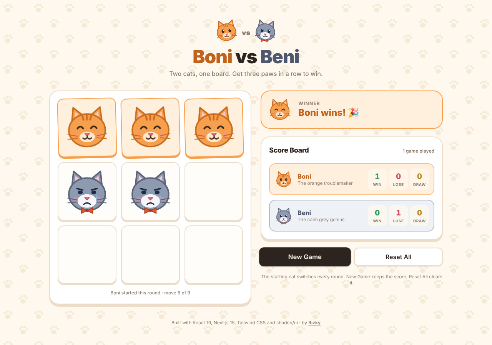

# Boni vs Beni · Tic-Tac-Toe

A two-player Tic-Tac-Toe game starring two cats, **Boni** and **Beni**. Built with **React 19**, **Next.js 16**, **Tailwind CSS**, and **shadcn/ui**.

🔗 **Live demo:** https://tictactoe-rizky.vercel.app
🎥 **Demo video:** _<Loom link>_



---

## Meet the Players

| | Character | Look |
| --- | --- | --- |
| 🧡 | **Boni** | The orange troublemaker: an orange tabby with forehead stripes |
| 🩶 | **Beni** | The calm grey genius: a grey cat with a white muzzle and a red bow tie |

Both cats are hand-drawn SVG components (`src/components/cat-face.tsx`), so no image files are needed. Each cat has three moods: **normal**, **happy** (wins), and **sad** (loses or draws).

## Features

- **Two-player turns.** Boni and Beni take turns on a 3×3 board.
- **Win and draw detection.** The game announces the winner or a draw.
- **Winning line highlight.** The winning cats bounce and smile, and the losing cat looks sad.
- **Score Board with Win / Lose / Draw.** Each cat has its own record.
- **Score saved in the browser.** The score is kept after a page refresh (localStorage).
- **Fair starts.** The starting cat switches every round.
- **New Game.** Clears the board and keeps the score.
- **Reset All.** Clears the board and the score.
- **Responsive and accessible.** Works on desktop and mobile, supports keyboard play, has screen-reader labels, and respects reduced-motion settings.

## Tech Stack

| Layer      | Tool                         |
| ---------- | ---------------------------- |
| Framework  | Next.js 16 (App Router)      |
| UI         | React 19, TypeScript         |
| Styling    | Tailwind CSS v4, shadcn/ui   |
| Testing    | Vitest                       |
| Deployment | Vercel                       |

## Project Structure

```
src/
├── app/
│   ├── globals.css         # Theme colors, animations, paw-print background
│   ├── layout.tsx          # Root layout and metadata
│   └── page.tsx            # Page header and footer
├── components/
│   ├── ui/                 # shadcn/ui Button and Card
│   ├── cat-face.tsx        # Boni and Beni SVG faces with moods
│   ├── game.tsx            # Puts the game together
│   ├── board.tsx           # 3×3 grid
│   ├── square.tsx          # Single cell
│   ├── status.tsx          # Turn, winner and draw message
│   └── score-board.tsx     # Win / Lose / Draw per cat
├── hooks/
│   └── use-game.ts         # Game state, score and persistence
└── lib/
    ├── game.ts             # Pure logic: moves, winner, draw, score
    ├── game.test.ts        # Unit tests for the game logic
    ├── score-store.ts      # Score saved in localStorage (useSyncExternalStore)
    └── utils.ts            # cn() class helper
```

The game logic in `lib/game.ts` is made of pure functions with no React code, so it can be tested on its own. The `useGame` hook manages state, and the components only render it and pass on clicks.

## Getting Started

**Requirements:** Node.js 20.9 or later

```bash
git clone https://github.com/rizkynfal/tictactoe-rizky.git
cd tictactoe-rizky
npm install
npm run dev
```

Open http://localhost:3000 in your browser.

## Scripts

| Command         | Description                  |
| --------------- | ---------------------------- |
| `npm run dev`   | Start the development server |
| `npm run build` | Build for production         |
| `npm run start` | Run the production build     |
| `npm run lint`  | Run ESLint                   |
| `npm test`      | Run the unit tests           |

## Deployment

```bash
npx vercel          # Link the project and create a preview deployment
vercel --prod       # Deploy to production
```

## How to Play

1. Boni starts the first round. Click an empty square to place your cat.
2. Players take turns.
3. The first cat to get three in a row (horizontal, vertical, or diagonal) wins.
4. If all nine squares are filled and nobody has three in a row, the game is a draw.
5. Click **New Game** to play again (the other cat starts), or **Reset All** to clear the score.

## Author

**Rizky** · [Portfolio](https://rizkynfal.vercel.app) · [GitHub](https://github.com/rizkynfal)
